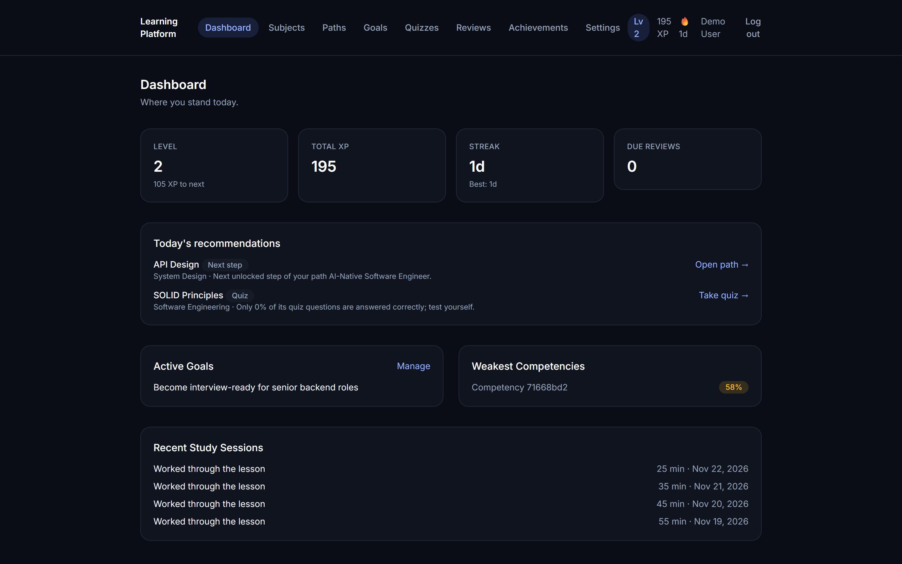

# Learning Platform


A personal learning and career-development platform: goals, subjects, competencies, learning paths, study sessions, mastery tracking, spaced repetition and gamification (XP, levels, achievements, quests, streaks). Built **AI-native** and designed to evolve toward AI-assisted, adaptive learning and interview/career readiness.

<!-- TODO: add dashboard / skill-tree screenshots, e.g.
<p align="center"></p> -->

## Features (v1)

- **Auth:** register / login / refresh with Argon2 password hashing and JWT
- **Skill tree:** subjects and competencies as *data, not code*, with prerequisites (locked → available → learning → mastered)
- **Learning paths, goals and study sessions**
- **Mastery score (0–100):** a transparent, deterministic formula combining engagement, practice and retention, kept separate from XP
- **Spaced repetition:** SM-2-lite review queue
- **Gamification:** XP, levels, streaks, achievements and quests
- **Dashboard:** level, XP, streak, active goals, due reviews, weakest competencies, recent activity
- **Content:** 30 competencies across 7 subjects, with 77 in-platform markdown lesson modules

## Engineering notes

- 20-table domain schema with Alembic migrations
- 51 backend tests (domain unit tests + API integration tests)
- Lint and type-check clean (ruff + mypy), CI on GitHub Actions
- Design decisions are recorded in [docs/DECISIONS.md](docs/DECISIONS.md); architecture in [docs/ARCHITECTURE.md](docs/ARCHITECTURE.md)
- The main user flow (register → set a goal → study → earn XP → see mastery) was verified end to end in a real browser against the real backend and database

## Tech stack

| Layer | Technology |
|---|---|
| Frontend | React, TypeScript, Vite, Tailwind CSS (deployed on Vercel) |
| Backend | Python, FastAPI, SQLAlchemy 2.0, Alembic (deployed on Railway) |
| Database | PostgreSQL (hosted on Railway) |

## Quick start

```bash
docker compose up -d          # local PostgreSQL

cd backend
python -m venv .venv
./.venv/Scripts/python.exe -m pip install -e ".[dev]"   # on Linux/macOS: ./.venv/bin/python
cp .env.example .env
./.venv/Scripts/python.exe -m alembic upgrade head
./.venv/Scripts/python.exe -m uvicorn app.main:app --reload

cd ../frontend
npm install
cp .env.example .env
npm run dev
```

Full developer instructions: [docs/DEVELOPMENT.md](docs/DEVELOPMENT.md).

## Roadmap

Planned, not yet built: an **AI Mentor** (an LLM-provider abstraction for explanations and feedback), adaptive learning and interview-readiness tracks. See [docs/ROADMAP.md](docs/ROADMAP.md) and [docs/PRODUCT.md](docs/PRODUCT.md).

## About

This is a single-owner tool, deliberately built to production-quality standards because that discipline is part of the learning goal.
